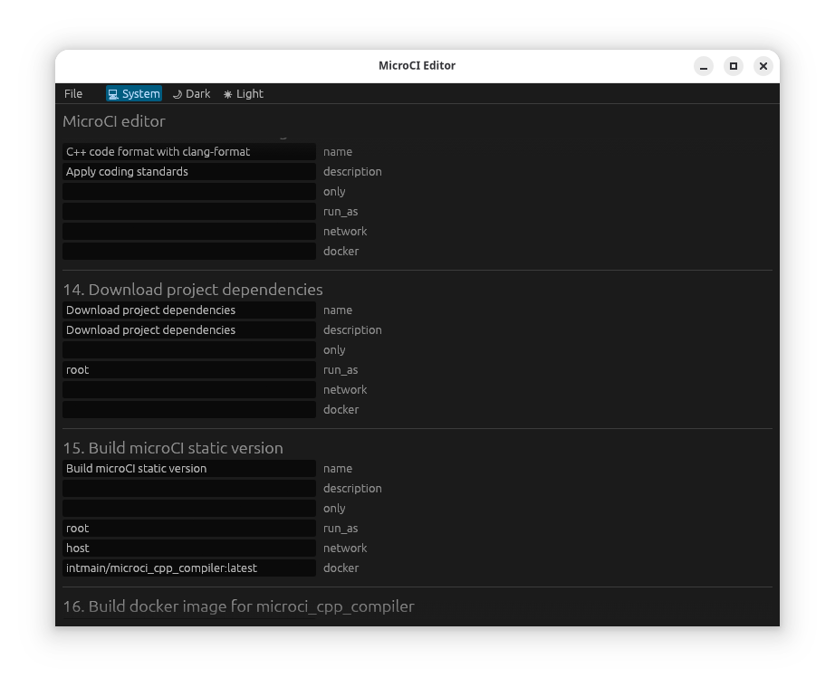

# MicroCI Editor

A native Rust/egui editor for [MicroCI](https://microci.dev/) workflow files.



The editor loads `.microCI.yml` from the current working directory, displays the workflow steps, and allows editing common step fields. YAML is parsed and stored with [`yaml-edit`](https://crates.io/crates/yaml-edit) so comments and formatting are preserved when the document is saved.

## Features

- Load `.microCI.yml` at startup
- Display all workflow steps dynamically
- Edit step fields such as `name`, `description`, `only`, `run_as`, `network`, and `docker`
- Preserve YAML comments and formatting
- Remove empty descriptions when saving
- Move non-empty `description` fields next to `name`
- Save with **File → Save** or `Ctrl+S`
- Quit with **File → Quit** or `Ctrl+Q`

## Requirements

- Rust 1.95 or newer
- A desktop environment supported by [eframe](https://github.com/emilk/egui/tree/master/crates/eframe)

## Web version

Try the WebAssembly version online:

[Open MicroCI Editor in the browser](https://geraldolsribeiro.github.io/microci-editor/)

The web demo uses the embedded `.microCI.yml` example.

## Installation

Install the latest published version from [crates.io](https://crates.io/crates/microci-editor):

```sh
cargo install microci-editor
```

This installs the `microci-editor` executable.

## Running

Create or copy a `.microCI.yml` file into the working directory, then run:

```sh
cargo run
```

The application aborts with a clear error if `.microCI.yml` is missing or invalid.

For the development workflow, the Makefile provides:

```sh
make bacon
```

This copies `microCI.yml.sample` to `.microCI.yml` and starts Bacon.

## Publishing

The crate can be packaged and published with:

```sh
make publish
```

The target runs formatting checks and tests before invoking `cargo publish`.

## License

Licensed under the MIT License. See [LICENSE-MIT](LICENSE-MIT).
